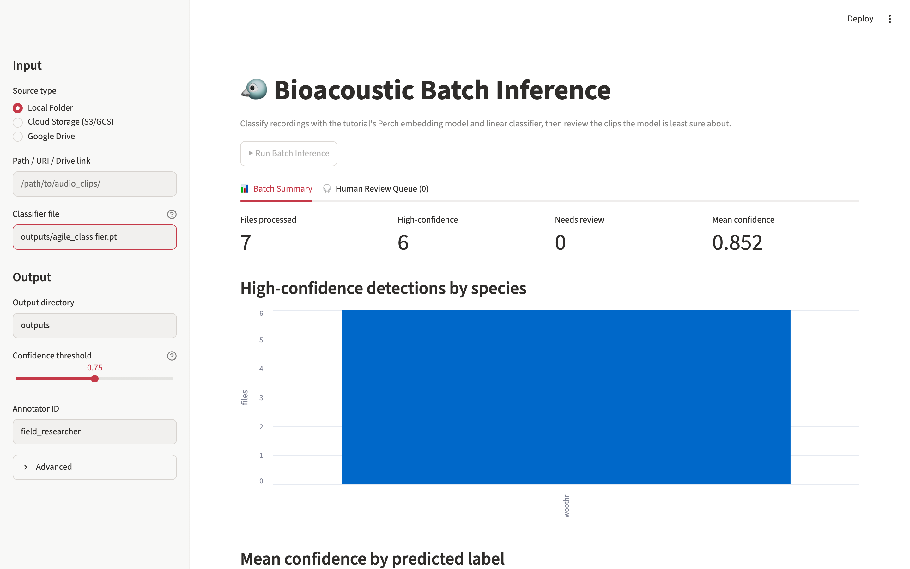
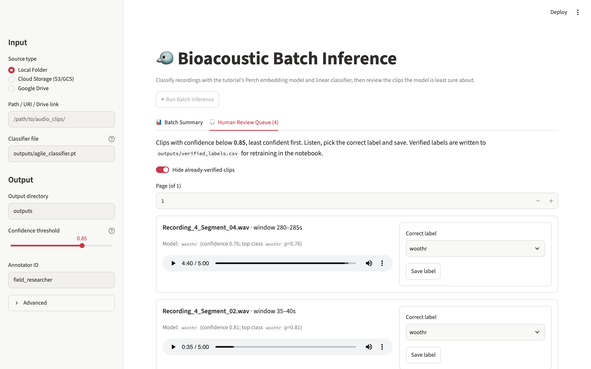

<!-- Header banner (free, no signup): https://github.com/kyechan99/capsule-render -->

  
  
  
  

  

## Hi, I'm Arkanil 👋

I'm a **Lead Data & Software Engineer** with about 10 years of shipping systems that real teams depend on: batch and streaming data pipelines, the platforms underneath them, and lately the AI products built on top.

What I'm good at, in plain terms:

- **Data engineering at scale.** Spark, Kafka, BigQuery, lakehouse tables (Iceberg/BigLake). Ingest messy data, model it properly and make it cheap to query.
- **AI engineering that's measured.** RAG and agent systems with hybrid retrieval, re-ranking, caching, tracing and **evals**. I don't trust an LLM feature I can't score.
- **Product-minded backend.** FastAPI services, Postgres, Docker, CI, and tests. I care about what the user actually gets, not just the architecture diagram.
- **Leading.** <!-- TODO: replace with your real numbers, e.g. "Led a team of 6 engineers; owned the data platform for 40M customer profiles" --> Setting technical direction, reviewing designs and mentoring engineers.

> 🇪🇸 **Looking for my next role in Spain** (Madrid on-site/hybrid, or remote within Spain). I'm eligible for Spain's **Highly Qualified Professional (HQP) / EU Blue Card** permit, a fast-track process that a sponsoring employer can complete in weeks. Happy to explain how it works.

---

## 🧰 What I work with

**Data**&nbsp;

<!-- Add only if true: Airflow, dbt, Databricks, Snowflake, AWS -->

**AI / ML**&nbsp;

**Backend & infrastructure**&nbsp;

---

## ⭐ Things I've built

### 🔎 [CDP RAG Assistant](https://github.com/arkanild/cdp-rag-assistant) · *in progress*
Customer data platform docs (Adobe Experience Platform, mParticle) are huge and fragmented, and engineers burn hours looking up identity-resolution and schema rules. This is a domain RAG assistant that answers those questions **with citations**.

- Hybrid retrieval (dense + BM25) with reciprocal rank fusion and cross-encoder re-ranking
- Parent-child chunking, a Redis semantic cache and a staleness check on source docs
- Evaluation harness: golden set, precision@k, MRR, RAGAS faithfulness, logged to BigQuery
- OpenTelemetry spans for every pipeline stage, plus a `/metrics/cost` endpoint for spend per query

`FastAPI` `Qdrant` `LangGraph` `Gemini` `Redis` `RAGAS` `BigQuery` `OpenTelemetry`
<!-- TODO: once evals run, add one line of real results here, e.g. "Faithfulness 0.91 · MRR 0.84 · p95 1.8 s". Numbers sell this project. -->

### 🐦 [Bioacoustic monitoring pipeline](https://github.com/climatechange-ai-tutorials/bioacoustic-monitoring/pull/5) · *open-source contribution to Climate Change AI*
The tutorial taught researchers to train a bird-species classifier in a notebook, but gave them no way to run it on new field recordings or feed corrections back. I turned it into a tool a non-programmer can use.

- Ingests audio from local folders, S3/GCS and Google Drive, then batch-scores it with Google's Perch v8 model
- Routes low-confidence clips to an active-learning review queue; corrupted files are logged, not fatal
- Streamlit dashboard to listen, relabel and export corrections for retraining
- Scores match the notebook exactly; 13 unit tests run in seconds without a GPU

`Python` `TensorFlow` `Perch` `Streamlit` `fsspec` `pytest`

  
  

### 🛠️ [daily-utils](https://github.com/arkanild/daily-utils) · *data engineering toolkit*
Small, tested building blocks I reach for at work: SFTP ingestion, BigQuery read/write in plain Python and Spark, and reusable PySpark transforms, with pytest fixtures for local Spark.

`PySpark` `BigQuery` `Bash` `pytest`

<!-- Make spark-biglake-metastore and kafka-connect public (with a README) and add them here.
     They are your best proof of "Lead Data Engineer" and nobody can currently see them. -->

---

## 🔭 What I'm doing right now

- Finishing the eval suite for **CDP RAG Assistant** and publishing the numbers
- Getting the bioacoustic pipeline reviewed and merged upstream
- Learning more about agent reliability: tool-call evals, guardrails and cost control in production

---

## 📈 Activity

  
  

<!-- Contribution snake, generated daily by .github/workflows/snake.yml -->
<picture>
  <source media="(prefers-color-scheme: dark)" srcset="https://raw.githubusercontent.com/arkanild/arkanild/output/github-contribution-grid-snake-dark.svg" />
  
</picture>

---

## 📫 Let's talk

I'm happy to talk about data platforms, RAG that has to work in production, or a role in Spain.

- 💼 **LinkedIn:** [linkedin.com/in/arkanildutta](https://www.linkedin.com/in/arkanildutta), the fastest way to reach me
<!-- - ✉️ **Email:** you@example.com  (uncomment and add your address if you want recruiters to email you directly) -->
- 📍 **Madrid, Spain** · CET · English <!-- TODO: add your Spanish level, e.g. "· Spanish (B1)" -->

